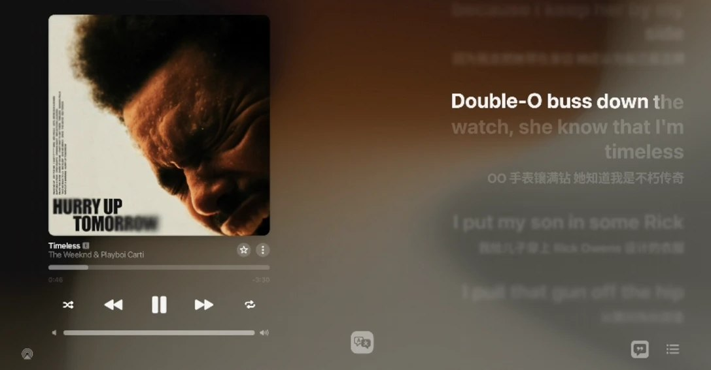
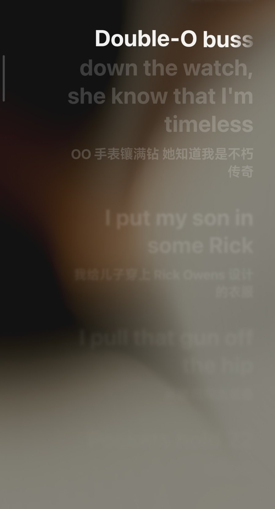

# AM背景Pro Max

<p align="center">
  把 Apple Music 安卓版的歌词页背景替换成流体材质：封面重度模糊后经过三层旋转与网格形变，可选接入系统音频的低频信号驱动。
</p>

<p align="center">
  
  
  
  <a href="LICENSE"></a>
</p>

<p align="center">
  简体中文
</p>

---

## 目录

- [简介](#简介)
- [效果展示](#效果展示)
- [功能](#功能)
- [环境要求](#环境要求)
- [安装](#安装)
- [设置项说明](#设置项说明)
- [音频律动](#音频律动)
- [兼容性](#兼容性)
- [从源码构建](#从源码构建)
- [项目结构](#项目结构)
- [工作原理](#工作原理)
- [常见问题](#常见问题)
- [已知限制](#已知限制)
- [来源与致谢](#来源与致谢)
- [许可证](#许可证)

## 简介

**AM背景Pro Max** 是一个独立的 [AM++](https://github.com/Zennmn/AM-plus-plus) 插件，通过 Xposed / LSPosed 作用于 `com.apple.android.music` 进程，接管播放器里的背景层 `LyricsBackgroundLayerView`，用 OpenGL ES 绘制一套流体背景。

它不是换一张图：背景会跟着歌词抽屉的开合程度逐帧改变透明度，收起时完全让位给 Apple Music 原生背景；播放时则是一层缓慢流动、被网格持续拉扯的模糊封面。

## 效果展示

<p align="center">
  
</p>

<p align="center">
  
</p>

## 功能

| 功能 | 默认 | 说明 |
| --- | --- | --- |
| 流体背景 | 开启 | 模糊封面 + 三层旋转 + 网格形变，GPU 绘制 |
| 跟随抽屉 | 无需设置 | 透明度按歌词页开合程度逐帧计算，收起时不遮挡其他界面 |
| 形变预设 | 全选 | 5 套网格预设；勾选多个时随机，只勾一个则固定 |
| 使用封面生成背景 | 开启 | 关闭后改用调色盘渐变 |
| 背景模糊 | 开启 | 控制渲染器里的高斯模糊 pass |
| 音频律动 | 关闭 | 需要配套应用，用系统音频的低频包络驱动形变 |

## 环境要求

| 项目 | 要求 |
| --- | --- |
| Apple Music | 7.0.0 系列，已验证版本码 `1606` / `1607` / `1609` / `1613` / `1614` |
| 模块框架 | 支持 libxposed API 102 的 Xposed（如 LSPosed），或 AM++ 的 npatch 嵌入版 |
| Android | 8.0（API 26）及以上 |
| 音频律动 | Android 10 及以上，且需安装配套应用 |

## 安装

1. 从 [Releases](../../releases) 下载 `am-bg-pro-max-<版本>.zip`。
2. 安装 [AM++](https://github.com/Zennmn/AM-plus-plus)，作用域只勾选 `com.apple.android.music`。
3. 在 AM++ 设置 → 插件 → 导入下载的 ZIP，打开启用开关。
4. 强制停止并重新打开 Apple Music。
5. 进入 Apple Music → 设置 → AM++ 模块设置 → 插件 → **AM背景Pro Max**，按需调整。

> 插件的启用、停用与删除在重启 Apple Music 后生效；其余设置项即时生效。

### 安装配套应用（仅音频律动需要）

1. 安装 Release 里的 `audio-capture-for-am-bg-pro-max-<版本>.apk`。
2. 插件设置中打开「读取播放音频」，点「打开音频捕获并授权」。
3. 在配套应用中启动捕获，按系统提示授予录音与播放捕获授权，然后返回 Apple Music。

## 设置项说明

| 设置 | 作用 | 生效方式 |
| --- | --- | --- |
| 启用背景替换 | 总开关 | 即时 |
| 使用封面生成背景 | 关掉后用调色盘渐变替代封面 | 即时 |
| 背景模糊 | 渲染器的高斯模糊 pass | 即时 |
| 形变预设 1–5 | 勾选多个 = 每次随机；只勾一个 = 固定 | 即时（重建网格） |
| 读取播放音频 | 启用插件与应用之间的低频通道 | 即时 |
| 打开音频捕获并授权 | 拉起配套应用完成授权 | — |
| 检查内录状态 | 显示当前连接、授权与静音状态 | — |

设置页顶部有一行自检信息，会显示宿主版本、背景层挂载情况与音频通道状态，排查问题时先看它。

## 音频律动

配套应用使用 Android `AudioPlaybackCapture` 读取系统播放音频，只在本机计算低频包络（不保存、不上传 PCM），再通过本机回环 socket 送给插件。

能否真正拿到声音取决于两件事，**都不由本插件决定**：

1. 系统是否授予 `RECORD_AUDIO` 与播放捕获授权；
2. Apple Music 自身的音频捕获策略，以及内容是否受 DRM 保护。

常见状态与含义：

| 状态 | 含义 | 处理 |
| --- | --- | --- |
| 正在连接音频捕获 | 插件还没连上应用 | 打开应用，或在设置里点「打开音频捕获并授权」 |
| 已连接，等待启动 | 已连上，但应用里还没开始捕获 | 在应用中启动 |
| 已授权但系统返回静音 | 权限有了，Apple Music 不给音频 | 平台限制，无法绕过 |
| 设备拦截了 Visualizer | 备用捕获也被拦截 | 换用系统播放捕获授权 |

## 兼容性

| Apple Music | 版本码 | 状态 |
| --- | --- | --- |
| 7.0.0 | 1614 | 已验证 |
| 7.0.0-beta | 1606 / 1607 / 1609 / 1613 | 已验证 |
| 其他版本 | — | 不支持，插件会明确报告 |

检测不到目标类时插件会直接报"不支持"，不会静默失效，也不会影响 Apple Music 正常播放。

## 从源码构建

需要 **JDK 17**、**Android SDK Platform 37** 与 **Build Tools 37.0.0**，用环境变量指向它们：

```powershell
$env:JAVA_HOME    = "C:\Program Files\Java\jdk-17"
$env:ANDROID_HOME = "C:\Android\Sdk"
```

构建插件：

```powershell
powershell -ExecutionPolicy Bypass -File project/build.ps1
```

产物为 `output/am-bg-pro-max-<版本>.zip`。

配套应用还需要签名材料，同样通过环境变量提供，密钥文件不要提交到仓库：

```powershell
$env:AMBG_KEYSTORE      = "C:\keys\release.keystore"
$env:AMBG_KEY_ALIAS     = "release"
$env:AMBG_KEYSTORE_PASS = "你的密码"
# 可选，未设置时与 keystore 密码相同
$env:AMBG_KEY_PASS      = "你的密码"

powershell -ExecutionPolicy Bypass -File audio-bridge/build.ps1
```

产物为 `output/audio-capture-for-am-bg-pro-max-<版本>.apk`。

AM++ Plugin API 的源码放在 `project/vendor`，仅作为编译接口，不随插件分发。

## 项目结构

```text
project/                插件
  src/main/java/        Java 源码
  vendor/               AM++ Plugin API（编译用）
  build.ps1             构建脚本
  plugin.json           插件清单
audio-bridge/           音频捕获配套应用
  src/                  Java 源码
  AndroidManifest.xml
  build.ps1
LICENSE                 Apache-2.0
NOTICE                  第三方声明
```

## 工作原理

1. 通过 AM++ 插件 API 挂钩背景层的构造函数，图层一创建就拿到实例。
2. 判断它是否占满屏幕（≥72% 宽、≥55% 高、≥50% 面积），排除迷你播放条上的同款图层。
3. 在同一个父容器里插入自己的 `GLSurfaceView`，隐藏原生层。
4. 每次 `setArtwork` 时抓取封面副本，交给 GL 线程做模糊与网格渲染。
5. 每帧读取歌词页的纵向位置，换算成背景透明度：抽屉收起 → 0 并恢复原生层，拉开 → 1。

## 常见问题

**装不上/提示版本降级？**
配套应用的 `versionCode` 若低于已安装版本，系统会拒绝安装。先卸载旧版，或在构建时提高 `versionCode`。

**背景是黑的？**
说明原生层已被隐藏，而插件图层没有渲染出内容。先看设置页自检里的"挂载"数字，再看 logcat：`adb logcat -s AppleMusicEnhancer`，过滤本插件 ID。

**音频一直静音？**
见[音频律动](#音频律动)。这是系统与内容保护的限制，插件没有绕过手段。

**影响 Apple Music 正常播放吗？**
不会。所有宿主交互都做了异常隔离，出错时退回原生背景。

## 已知限制

- 只支持 Apple Music 7.0.0 系列，其他版本会明确报告不支持。
- 竖屏下 5 个形变预设映射为 4 种形状（预设 3 与 4 相同），横屏才是 5 种。
- 音频律动在没有授权或内容受保护时不可用，且没有替代方案。
- 尚未覆盖全部机型与系统版本，渲染帧率与功耗随设备而异。

## 来源与致谢

本项目**不是** Lyricify 的插件，也不代表 Lyricify 或其开发者发布；两者之间没有隶属、授权或背书关系。

视觉管线（网格控制点、Catmull–Clark 细分、高斯模糊核、色彩处理参数与三层旋转结构）移植自开源项目
[WXRIW/Lyricify-Backgrounds](https://github.com/WXRIW/Lyricify-Backgrounds)，该项目以 Apache License 2.0 发布：

- `AppleMusicIosMesh.cs` → `project/src/main/java/dev/zen/lyricbg/render/MeshPresets.java`、`MeshWarp.java`
- `AppleMusicIosBackground.hlsl` → `project/src/main/java/dev/zen/lyricbg/render/FluidGlRenderer.java`、`BlurKernel.java`

感谢 WXRIW 及 Lyricify-Backgrounds 的作者公开这些实现。宿主的版本适配信息来自 [AM++](https://github.com/Zennmn/AM-plus-plus) 的公开 profile。

## 许可证

本项目以 [Apache License 2.0](LICENSE) 发布。第三方声明见 [NOTICE](NOTICE) 与 [`project/THIRD-PARTY-LICENSES.txt`](project/THIRD-PARTY-LICENSES.txt)。

> 非官方项目，与 Apple Inc. 无关联。仅供个人学习与自用。
